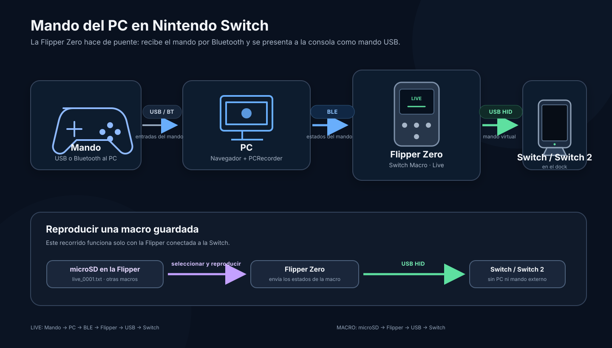

# Switch Macro para Flipper Zero

**Usa mandos USB o Bluetooth conectados al PC en Nintendo Switch y Switch 2 a través de tu Flipper Zero.** Graba macros desde la propia Flipper y reprodúcelas después sin PC ni mando. El mando debe aparecer en el navegador como un gamepad estándar; la detección USB puede depender de la consola y su firmware.

## Mini manual

1. Copia `dist/SwitchMacro.fap` a `apps/USB/` en la microSD, conecta la Flipper al dock y abre **Apps → USB → Switch Macro**. El menú ofrece **Macros**, **Live relay** y **Simulator**.
2. Para jugar con un mando del PC, elige **Live** en la Flipper y ejecuta `PCRecorder/start-local.cmd`. Selecciona el mando en el navegador y conecta la Flipper por Bluetooth; el relé se activa al conectar ambos.
3. En **Live Relay**, pulsa **OK** para entrar en **Recorder**. Usa **Arriba/Abajo** para elegir **START RECORDING** o **VIEW CONTROLLER**; la vista a pantalla completa del mando no detiene la grabación y **Atrás** vuelve al recorder. **STOP AND SAVE** guarda la macro como `live_NNNN.txt` en `/ext/apps_data/switch_macro/`. Volver atrás desde Recorder mantiene Live activo; salir atrás desde Live Relay apaga el relé y guarda una grabación activa.
4. Para reproducirla sin PC ni mando, entra en **Macros**, selecciónala con **Arriba/Abajo** y pulsa **OK** para abrir sus detalles. Allí verás duración y pasos; activa **Loop** si quieres repetirla y elige **PLAY** para iniciar. **Derecha** abre las opciones para renombrar o borrar.
5. Cada vez que el USB se configura o se reconecta, el FAP manda una pulsación breve de **A** y la suelta para despertar el mando en la Switch. No forma parte de las macros ni de la grabación Live. En **Simulator**, las flechas mueven el foco por el dibujo; mantén **OK** para mantener pulsado el botón virtual y suéltalo para liberar el botón. Selecciona un stick analógico y pulsa **OK** para entrar en su ajuste; las flechas mueven el eje y **OK** vuelve a la navegación. **L3/R3** se seleccionan por separado. **Atrás** envía estado neutro y vuelve al menú.



La Flipper se conecta a la Switch por USB; el Bluetooth se usa entre la Flipper y el PC durante Live.

## Relé en directo y grabación desde la Flipper o el PC

En Windows, abre `../PCRecorder/start-local.cmd`, conecta el mando al PC por USB o Bluetooth y selecciónalo en Chrome o Edge. Conecta la Flipper por USB al dock y elige **Live** en el menú del FAP: el modo BLE queda activo. En el navegador, conecta la Flipper por Bluetooth; al detectar la conexión y el mando seleccionado, el relé se enciende automáticamente.

También puedes grabar desde la Flipper mientras el relé sigue activo. **Live** abre el panel Recorder, que muestra estado, tiempo y pasos sin el dibujo del mando. Dentro del recorder, selecciona **VIEW CONTROLLER** para ver el mando a pantalla completa: se resaltan los botones, la cruceta y la posición de los sticks en tiempo real, mientras la grabación continúa. **Atrás** vuelve al recorder. Selecciona **START RECORDING** para iniciar y **STOP AND SAVE** para guardar. **Atrás** desde Recorder vuelve al menú Live sin detener el relé; **Atrás** desde ese menú detiene Live y guarda automáticamente una grabación activa. La macro se guarda en la microSD como `live_NNNN.txt` y aparece después en **Macros**. Mientras juegas, los estados se acumulan en RAM; la microSD solo se escribe al guardar. La grabación desde el PC sigue siendo independiente. Los errores de transmisión muestran el endpoint.

En la distribución estándar del Gamepad API, los botones de cara se traducen por posición al diseño de Switch: abajo→B, derecha→A, izquierda→Y y arriba→X. Los botones centrales Select/Back y Start se guardan como `MINUS` y `PLUS`, respectivamente. Si el navegador indica que el mando no tiene mapeo estándar, los nombres pueden variar. La herramienta captura además L3/R3, Home, Share/Capture (si el navegador lo expone como botón 17), cruceta y sticks; aplica zona muerta y cuantiza ejes para evitar ruido.

La cruceta usa el mapa HID estándar: izquierda→`0x06`, derecha→`0x02`, arriba-izquierda→`0x07` y arriba-derecha→`0x01` (abajo-izquierda→`0x05`, abajo-derecha→`0x03`).

Copia los archivos `.txt` de macro a esta carpeta de la microSD. Después podrás administrarlos y reproducirlos desde la pantalla de la Flipper:

```text
/ext/apps_data/switch_macro/
```

En la pantalla inicial, **Arriba/Abajo** elige entre **Macros**, **Live relay** y **Simulator**; **OK** entra en la opción seleccionada. Cada vez que el USB se configura o reconecta, el FAP envía una pulsación y liberación de **A** para inicializar la conexión de mando con la Switch. En **Simulator**, usa las flechas para seleccionar los controles dibujados y mantén **OK** para pulsar uno; suelta **OK** para liberarlo. Para mover sticks, selecciona uno, pulsa **OK** y usa las flechas; pulsa **OK** otra vez para volver a la navegación. **L3/R3** son botones independientes. **Atrás** envía neutral y vuelve al menú. En **Macros**, **Arriba/Abajo** elige el archivo y **OK** abre su pantalla de detalles con el número de pasos, duración, progreso durante la reproducción y el control **Loop**. **Derecha** abre las opciones de reproducir, renombrar o borrar; el borrado pide confirmación. **Atrás** vuelve a la pantalla anterior. El gestor muestra hasta 24 archivos `.txt` de la carpeta.

Para renombrar, usa el teclado QWERTY en pantalla: las flechas seleccionan teclas y **OK** inserta el carácter. **Arriba** desde la primera fila activa el cursor del nombre; usa **Izquierda/Derecha** para moverlo y **Abajo** para volver al teclado. **DEL** borra el carácter anterior, **SYM** cambia a símbolos y **SAVE** guarda; **Atrás** cancela. La extensión `.txt` se conserva.

El FAP solo lista archivos que ya están en la microSD. Para transferir una macro desde otro dispositivo o instalar el FAP, todavía hay que copiar el archivo a la microSD por un medio externo.

## Formato

El formato admite líneas de pulsación sencilla y estados completos:

```text
# Pulsación sencilla: se suelta al terminar
A 120
WAIT 250
A+B 100
UP 300

# Estado persistente: el siguiente STATE cambia el mando sin soltarlo entre medias
STATE A+LX:224+LY:128+RX:128+RY:128 150
STATE A+B+UP+LX:224+LY:0+RX:128+RY:128 200
STATE NONE 80
```

`STATE` conserva los botones, la cruceta y los ejes durante el intervalo indicado; la siguiente línea cambia al nuevo estado. `NONE` significa botones y cruceta sueltos. Los ejes admiten valores de 0 a 255; 128 es el centro. `WAIT` pone el mando en neutral durante su intervalo. `#` inicia un comentario.

Botones: `A`, `B`, `X`, `Y`, `L`, `R`, `ZL`, `ZR`, `PLUS`, `MINUS`, `L3`, `R3`, `HOME` y `CAPTURE`. Direcciones: `UP`, `DOWN`, `LEFT`, `RIGHT`, `UP_LEFT`, `UP_RIGHT`, `DOWN_LEFT` y `DOWN_RIGHT` (también se aceptan sin guion bajo). Usa `+` para mantener varios controles juntos. Ejes: `LX`, `LY`, `RX`, `RY`.

Cada duración debe estar entre 1 y 60000 ms. El archivo admite hasta 24 KB y 512 estados. Tras editarlo, cierra y vuelve a abrir el FAP para cargar la versión nueva.

## Reproducción independiente

1. Copia `dist/SwitchMacro.fap` a `apps/USB/` en la microSD.
2. Conecta la Flipper al dock de la Switch por USB y abre **Apps → USB → Switch Macro**.
3. En el menú inicial entra en **Macros**, elige un `.txt` con **Arriba/Abajo** y pulsa **OK** para ver sus detalles. Activa **Loop** opcionalmente y selecciona **PLAY**. **Derecha** abre las opciones de renombrar y borrar. En el renombrador, **OK** introduce la tecla seleccionada y la tecla **SAVE** aplica el nuevo nombre. Para relé en directo, vuelve al menú y entra en **Live**; **OK** abre Recorder y desde allí puedes mostrar el mando sin interrumpir la grabación.

El relé usa el perfil BLE Serial del firmware y un paquete de estado compacto; el navegador necesita ejecutarse desde `127.0.0.1` para usar Web Bluetooth. Si se pierde el enlace BLE, el FAP suelta los controles al dejar de recibir paquetes. El FAP conserva las dos interfaces HID del port anterior (mando Switch y teclado boot), pero solo genera informes del mando. La consola debe aceptar entradas de mando y estar conectada por el dock en modo TV.

## Compilar

Instala uFBT y ejecuta desde esta carpeta:

```powershell
./build.ps1
```

El resultado se copia a `dist/SwitchMacro.fap`. El FAP debe validarse en la Flipper y la Switch concretas.
